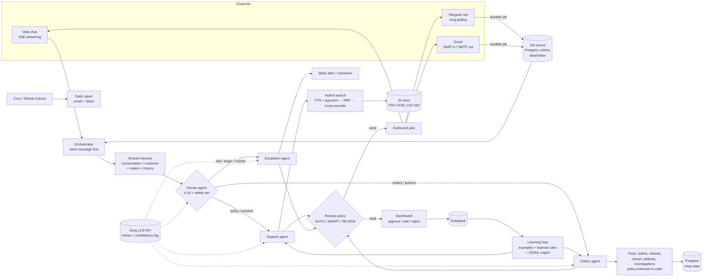

# Brightbasket AI Ops — an autonomous customer-operations agent

A multi-agent AI system that runs customer operations for a UK e-commerce shop (fictional **Brightbasket Home**, homeware): it answers customers on web chat, Telegram and email, takes real actions on orders, escalates risky conversations to humans, learns from human corrections and sends management a daily report.

**Live demo:** https://asad455-cadral-ai-ops-agent.hf.space · **Dashboard login:** `admin@demo.shop` / `admin123` (admin) or `agent@demo.shop` / `agent123` (agent) · **Customer chat:** https://asad455-cadral-ai-ops-agent.hf.space/#/chat

> Built for the Cadral AI technical assessment. Stack: TypeScript, Node.js (Fastify), Postgres + pgvector, React, Groq (GPT-OSS 120B / 20B), transformers.js, Docker. Free tiers only.

---

## What it does (mapped to the brief)

| Requirement | How it is built |
|---|---|
| **1. Multi-agent system** | `router` → `support` / `orders` / `escalation` agents ([server/src/agents](server/src/agents)). The router is an LLM classifier with a deterministic safety net (legal, safety, fraud, "speak to a human" always escalate). All agents share one memory: the conversation, the customer profile, recent orders and past conversations ([memory.ts](server/src/agents/memory.ts)). |
| Real tool calls | The orders agent calls real functions that read and write Postgres: `list_my_orders`, `get_order`, `issue_refund`, `cancel_order`, `update_shipping_address`, `report_delivery_problem` ([tools.ts](server/src/agents/tools.ts)). **Business rules live in code, not the prompt**: 30-day window, no refunds on unshipped orders, customers can only see their own orders, refunds over £100 wait for an admin. |
| Escalation | Detects anger / legal / safety / fraud / privacy, writes a handover summary, opens an escalation, alerts Slack and tells the customer when a human will reply (aware of UK opening hours). |
| **2. Advanced RAG** | 24 documents: 6 PDFs, 12 HTML pages, 4 Markdown, 2 CSV tables ([data/docs](data/docs)). Heading-aware chunking. **Hybrid search**: Postgres full-text + pgvector cosine, fused with Reciprocal Rank Fusion, **reranked** with a cross-encoder (ms-marco-MiniLM). **Citations** `[n]` on every answer, validated after generation. Says **"I don't know"** when retrieval relevance is low, when the model says so, or when an answer comes back without valid citations ([search.ts](server/src/rag/search.ts), [support.ts](server/src/agents/support.ts)). |
| **3. Fine-tuning** | Qwen2.5-1.5B + LoRA for the router's classification task, compared with the base model and with GPT-OSS 120B on accuracy, macro-F1, latency and cost ([finetune/](finetune)). See [WRITEUP.md](WRITEUP.md#fine-tuning). |
| **4. Self-improving loop** | Approve / edit / reject on the dashboard is stored as feedback with an embedding. Similar past corrections are injected as examples next time; recurring corrections are distilled into **learned rules** (visible and switchable on the dashboard); approved/edited pairs **export as a JSONL fine-tuning dataset** ([learning.ts](server/src/agents/learning.ts)). |
| **5. Automation** | 3 channels: web chat (streaming), **Telegram** bot, **email** (IMAP in, SMTP/Brevo out). **Daily management report** by email + Slack (volume, top issues, refunds, AI accuracy, cost). **Slack alerts** for escalations, refunds awaiting approval and system errors. **Durable job queue** in Postgres with exponential backoff and dead-lettering: inbound messages are stored before any API call, so nothing is lost if an API fails ([queue.ts](server/src/jobs/queue.ts)). |
| **6. Full-stack dashboard** | React. Login with **roles** (admin, agent). Live conversation view (SSE) with **streaming** customer replies, **agent trace** (route decision, retrieved chunks with scores, every tool call with its reason and result), approve / edit / reject, human takeover, refund approvals, escalations, **analytics** (auto-resolution %, response time, cost per conversation, accuracy over time). |
| **7. Evals & monitoring** | 60 scripted cases across FAQ, "I don't know", order lookups, actions with real DB side effects, policy, security (prompt injection, other customers' orders) and escalation. **One command** — `npm run eval` — prints a score. Token cost and latency are logged for every LLM call. |
| **8. Deployment** | One Docker image (API + workers + dashboard). Runs on a free Hugging Face Space (see `deploy/hf-space/app.py`), with Neon Postgres (free) when `DATABASE_URL` is set. Secrets only in environment variables. CI on GitHub Actions. |

## Architecture



Request lifecycle: **store → remember → route → act → review → deliver → learn.**
1. The inbound message is written to Postgres before anything else (Telegram and email arrive as jobs).
2. Shared memory is loaded once and given to every agent.
3. The router picks a specialist; the safety net can only *raise* risk, never lower it.
4. The specialist answers (support), calls tools (orders) or hands over (escalation). Every step is written to the `traces` table.
5. The review policy decides: send now, or hold for a human (low router confidence, borderline retrieval, or REVIEW mode).
6. Delivery goes through the job queue with retries; web chat streams tokens over SSE.
7. Human edits and rejections feed the learning loop.

## Run it locally

```bash
npm install
npm run make:docs          # writes the 24 knowledge-base files into data/docs
cp .env.example .env       # optional: add LLM_API_KEY (free Groq key) — without it a deterministic mock LLM is used
npm run build:web
npm start                  # http://localhost:7860  (embedded Postgres via PGlite, no setup)
```

With Docker and a real Postgres + pgvector: `docker compose up --build`.

## Evals

```bash
npm run eval                       # all 60 cases, prints score by category, latency and cost
npm run eval -- --only=escalation  # one category
```
Each case runs in its own copy of a freshly seeded database, so side effects (refunds, cancellations) are checked with SQL. Results are saved to `evals/results/` and shown on the dashboard.

## Fine-tuning

```bash
npm run finetune:dataset   # regenerates finetune/data/{train,test}.jsonl
```
Open [`finetune/finetune_router.ipynb`](finetune/finetune_router.ipynb) in Google Colab (free T4 GPU), run all cells, and commit the downloaded `results.json` to `finetune/results.json`.

## Deploy (free)

1. **Neon** → create a project → copy the connection string (`DATABASE_URL`).
2. **Groq** → create an API key (`LLM_API_KEY`).
3. **Hugging Face** → New Space → Gradio SDK (free tier) → upload [`deploy/hf-space/app.py`](deploy/hf-space/app.py). On start it downloads Node 22, clones this repo, builds the dashboard and runs the server on port 7860. (Docker Spaces need a paid plan; the `Dockerfile` works on any Docker host.)
4. Space → Settings → **Variables and secrets**: add the variables from `.env.example` (`DATABASE_URL`, `LLM_API_KEY`, `JWT_SECRET`, `PUBLIC_URL`, `TELEGRAM_BOT_TOKEN`, `SLACK_WEBHOOK_URL`, `EMAIL_*`/`BREVO_API_KEY`, `REPORT_EMAIL_TO`, `CRON_KEY`).
5. GitHub repo → Settings → Secrets → `APP_URL`, `CRON_KEY` (for the daily-report workflow).

## Project layout

```
server/src/
  agents/      router, support, orders, escalation, orchestrator, tools, memory, learning, prompts
  rag/         ingestion (PDF/HTML/CSV/MD), embeddings, hybrid search + reranking
  channels/    telegram, email, notify (Slack, email, daily report)
  jobs/        durable queue with retries
  llm/         OpenAI-compatible client (Groq) with retries + cost/latency logging; offline mock
  api/         REST + SSE endpoints, JWT auth with roles
  db/          schema.sql, seed
web/src/       React dashboard + customer chat
data/          knowledge-base source and generated documents, demo shop data
evals/         60 cases + runner
finetune/      dataset generator, Colab notebook, results
```

See [WRITEUP.md](WRITEUP.md) for architecture decisions, trade-offs, fine-tuning results, eval scores and what breaks at scale.
